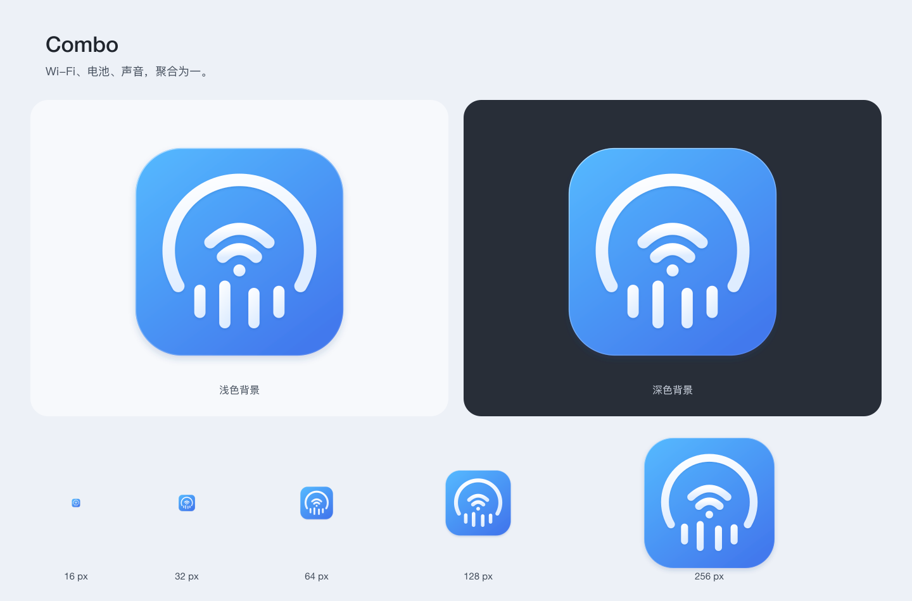

# Combo · 当前 AppIcon

确认日期：2026-11-06。当前稿已用于原生 AppIcon、README 和面板／设置／引导设计稿。



## 文件与导出

- [`combo-app-icon.svg`](combo-app-icon.svg)：唯一可编辑矢量主稿。
- `combo-app-icon-{16,32,64,128,256,512,1024}.png`：透明背景导出。
- [`preview.png`](preview.png)：浅深背景及 16–256px 尺寸对照。
- [`render.cjs`](render.cjs)：使用现有 sharp 导出 PNG 和预览，检查尺寸、透明度及主要图形的可见像素。

在已有 sharp 的 Node.js 环境运行：

```sh
NODE_PATH=<现有 node_modules> node docs/assets/brand/liquid-glass/render.cjs
```

导出后同步范围及来源元数据要求见[品牌说明](../README.md)。

## 当前几何

1024px 透明画布；底座为 `(100,100,824,824)`，圆角 184px。背景从 `#55BAFF` 渐变到 `#4279ED`，标志为 `#FFFFFF → #DFEDFF`，保留柔和落影和细边缘光。

外弧为 `M20.6 65 A34 34 0 1 1 79.4 65`，宽 6、圆头。四柱横向中心为 31、43、57、69，底沿为 80.4、85.4、85.4、80.4；长度为 16、23、19.5、15.5，宽 5.4、圆角 2.7。柱体竖直、两侧上提、中间下沉；整体以 8.24 倍放大并置于 `(100,112)`。

音乐柱是播放态的静态表达，PNG 不含动画；16px 以整体轮廓辨识为主。未采用候选及被替代的外弧方案已移除，保留当前批准稿。

## 验证边界

此前集成已记录：原生 10 个文件与批准稿一致，Debug 构建和品牌检查通过，编译产物包含全部 AppIcon 表示。详细历史证据见 `.impeccable/review/app-icon/finish-review.md`。

本次资料整理核对当前分发件、原生图标尺寸及文件一致性，不重新声明此前设计审查或原生构建结果。未安装、发布或验证 Finder/Dock 缓存显示。
