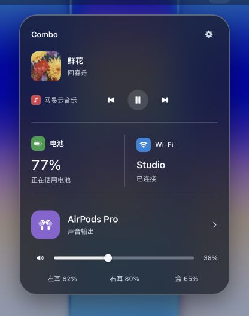
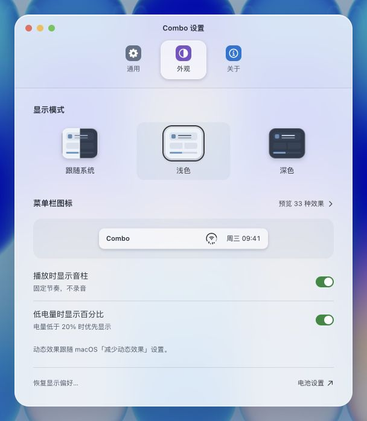
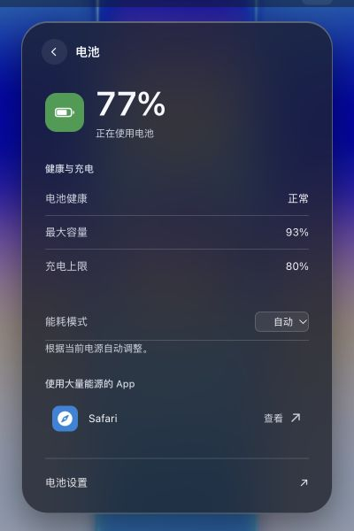
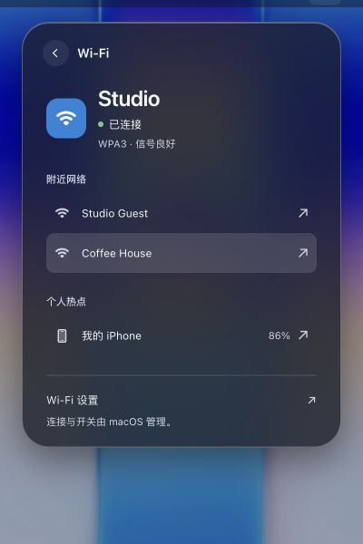
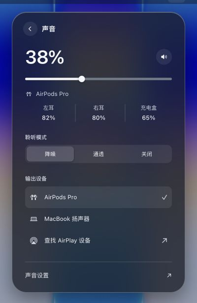
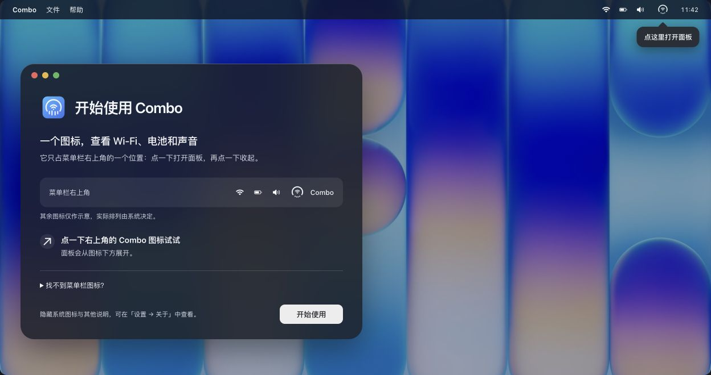

# Combo 1.3.0 · 界面设计稿

整理日期：2026-11-06。此目录为 1.3.0 界面更新的当前设计资料，覆盖总览、详情、设置和引导。相应 SwiftUI/AppKit 实现已在工作区调整；本文截图来自浏览器稿，不代替原生运行验证。源码版本仍为 `1.2.0 / 102`，未据此声明 1.3.0 已发布。

## 预览与原稿

统一入口：[打开总设计稿](index.html)。顶部导航可切换「面板与详情」「设置」「使用引导」「AppIcon」「中央图标」「音频与充电」；也可[直接查看引导页](index.html#onboarding)。图标资料统一见[图标设计汇总](icons/README.md)。

| 内容 | 可交互预览 | 可编辑原稿 |
| --- | --- | --- |
| 总览面板及详情 | [打开面板设计](combo-panel-liquid-glass.html) | [面板源稿](sources/combo-panel-liquid-glass.html) |
| 独立设置窗口 | [打开设置页设计](combo-settings-liquid-glass.html) | [设置页源稿](sources/combo-settings-liquid-glass.html) |
| 使用引导 | [打开引导设计](combo-onboarding-liquid-glass.html) | [引导源稿](sources/combo-onboarding-liquid-glass.html) |
| AppIcon | [浅深背景与尺寸预览](icons/preview.html) | [SVG 主稿与导出说明](icons/app-icon.md) |
| 中央图标 | [49 个设备与状态](icons/central.html) | [源稿](icons/sources/central.html) · [设计与符号映射](icons/central.md) |
| 音频与充电 | [39 个设备、电量与充电场景](icons/audio.html) | [源稿](icons/sources/audio.html) · [最终设计说明](icons/audio.md) |

用浏览器打开预览文件即可查看。面板默认展示「融合面板」，底部可切换「控制中心」作对照；设置页默认展示「外观」。按钮、链接、音量滑杆和选中态采用中性石墨灰／银白色；开关以绿色表示开启、灰色表示关闭。

## 本版 UI 改动与配图

| 范围 | 当前设计 |
| --- | --- |
| AppIcon | 简洁蓝白底座、电量弧、Wi-Fi 双弧与圆弧音乐柱；见 [源稿与尺寸预览](icons/README.md) |
| 总览与详情 | 一体式玻璃外壳、媒体优先、电池与网络并列、底部声音控制；三页详情统一返回和系统设置入口 |
| 设置 | 顶部「通用／外观／关于」工具栏；外观选择、实时菜单栏预览、独立 33 种效果总览 |
| 引导 | 菜单栏入口提示、开合反馈、按需展开帮助、始终可用的「开始使用」 |

截图统一存放于 [`docs/assets/ui-1.3.0/`](../../assets/ui-1.3.0/README.md)，中英文 README 共用。保留原稿中文和示例状态，不把设计图标为实机截图。

| 总览 · 深色 | 设置 · 浅色 |
| :---: | :---: |
|  |  |

| 电池详情 | Wi-Fi 详情 | 声音详情 |
| :---: | :---: | :---: |
|  |  |  |



## 面板

以轻量菜单栏工具为定位，采用一体式 Liquid Glass 外壳，通过间距与分隔线组织信息。

| 位置 | 内容与入口 |
| --- | --- |
| 顶部 | Combo 标题、设置入口 |
| 第一行 | 媒体封面、曲目、来源、播放控制 |
| 第二行 | 电池和 Wi-Fi 状态，可进入各自详情 |
| 第三行 | 声音与输出设备、音量、耳机电量，可进入声音详情 |

图标采用原生 SF Symbols 造型，以绿、蓝、紫区分电池、网络与声音。融合方案减少独立卡片层级；控制中心方案保留模块化布局。

面板中的设置按钮可打开配套设置窗口，关闭后返回原面板并恢复入口焦点。媒体控制、音量和输出设备选择保留示例交互。

### 详情页

电池、Wi-Fi 和声音详情共用圆形返回按钮、一体式玻璃外壳和底部系统设置入口；以间距和细分隔线组织内容。

| 详情 | 内容顺序 |
| --- | --- |
| 电池 | 当前电量与供电状态、健康与充电、能耗模式、使用大量能源的 App |
| Wi-Fi | 当前连接与信号、附近网络、个人热点、系统设置入口 |
| 声音 | 音量与静音、当前输出与耳机电量、聆听模式、输出设备 |

能耗模式支持示例选择与保存；音量、静音和输出选择同步到总览。切换至扬声器后收起耳机专属内容。返回按钮和 Escape 均恢复总览入口焦点，外观统一由设置页控制。

## 设置窗口

保留 macOS 原生顶部工具栏的结构与交互方向，使用玻璃工具栏、清晰的内容分组和紧凑设置行。

| 工具栏分类 | 内容 |
| --- | --- |
| 通用 | 登录时启动、界面语言、系统连接、退出入口 |
| 外观 | 跟随系统／浅色／深色、菜单栏图标、播放音柱、低电量百分比、恢复偏好 |
| 关于 | 版本、更新、使用引导、隐藏系统图标、隐私与状态 |

外观页的「预览 33 种效果」进入独立子视图，通过「返回外观」退出。子视图提供放大图、菜单栏实际大小、名称、触发条件、分组目录和项内变体；「当前状态」使用明确标注的示例数据。

原生设置已按[中央图标汇总](icons/central.md)将 30 类音频设备和 Wi-Fi 连接中状态展开为独立条目，共 51 种；入口和总数随目录自动计算。下文 33 种及浏览器设置稿保留原设计快照，当前原生行为见[设置规格](../../product/behavior.md#settings)。

### 图标效果总览

已纳入[「补充效果预览状态总览」](codex://threads/01a1a9ce-b4f6-70f2-a4a6-f0c2e9229363)中的图标预览，图像来自 Combo 的 IconRenderer 离屏渲染。

| 分组 | 场景数 | 覆盖范围 |
| --- | --- | --- |
| 网络 | 4 | Wi-Fi 正常、关闭、无可用路径、等待识别 |
| 音频设备 | 13 | AirPods 系列、Beats、通用耳机、音箱、车载、助听设备及 AirPlay 设备 |
| 电量与供电 | 8 | 正常、低电量、0%、100%、未知、充电、插入与拔出提示 |
| 音量与播放 | 8 | 静音、音量 1–4 档、由设备控制／未知、播放音柱、调整音量提示 |

另有 10 个项内变体取值：充电 5 个、播放 2 个、音量提示 3 个，不另计为主场景。播放音柱提供动态和静态变体；电源插拔与音量提示采用定格展示。

## 使用引导

保留现有功能，将流程组织为「认识菜单栏入口 → 尝试打开与收起 → 开始使用」。采用原生欢迎窗口、一体式玻璃、中性主按钮和与面板一致的 SF Symbols。

- 顶部指引指向菜单栏中的 Combo 图标。点击图标打开面板，再点收起，欢迎窗口实时反馈当前状态。
- 「开始使用」始终可用，按回车即可结束引导；无需先完成演示。结束后隐藏欢迎窗口，仍可打开菜单栏面板；「重新查看引导」供设计预览复看。
- 保留菜单栏排列示意、Command 拖动帮助，以及「设置 → 关于」的系统图标说明。帮助按需展开。
- 无内置电池时，收起电池相关图标、文案与示例内容。预览调节支持外观和辅助功能选项，不代表新增 App 设置。

## 设计依据与维护

- 以 macOS Human Interface Guidelines、`build-macos-apps:swiftui-patterns` 和 `apple-design` 为基础，沿用 Impeccable 的 Operate 审查方向，优先保证扫读、状态识别和可靠操作。
- 图标与壁纸已内嵌在稿件中。预览外壳会从 unpkg 加载运行库，尚未验证完全离线使用。
- `sources/` 保存可编辑的 HTML 片段，外层同名文件为完整浏览器导出版。设置页只维护 `sources/combo-settings-liquid-glass.html`，面板源稿通过 include 标记引用它，导出时自动内嵌；不要直接修改导出版。
- `icons/` 统一保存 AppIcon、中央图标、音频与充电设计。AppIcon 各尺寸 PNG 直接输出到原生资源目录，不在文档侧重复保存；其余图标保留最终 HTML 源稿、符号映射和浏览器导出版。
- 更新 HTML 稿后，运行以下命令统一导出五页；参数为已安装 visualize 的 `scripts/render.py` 的实际路径：

```sh
python3 docs/design/liquid-glass/render.py <visualize-skill>/scripts/render.py
python3 Tests/Views/DesignAssetsCheck.py
node Tests/Views/OnboardingPrototypeCheck.cjs
```

## 验证与边界

2026-11-06 本次资料整理实际打开了当前导出版，截取总览、电池／Wi-Fi／声音详情、浅色设置与使用引导，并核对截图内容与资源引用。未改动设计源稿或原生界面代码。

2026-11-12 清理历史审查截图、校验 HTML、旧审查记录与闲置素材，并统一 AppIcon 位置。有效的引导交互检查已迁至 `Tests/Views/OnboardingPrototypeCheck.cjs`，设计导出和图标一致性由 `Tests/Views/DesignAssetsCheck.py` 检查。历史检查结果不作为当前原生验收结论。

浏览器稿使用示例状态，不操作真实设备或系统设置；材质与系统辅助功能表现仍以原生 App 为准。本次未构建、安装或发布应用，未核验在线 Release 状态。
