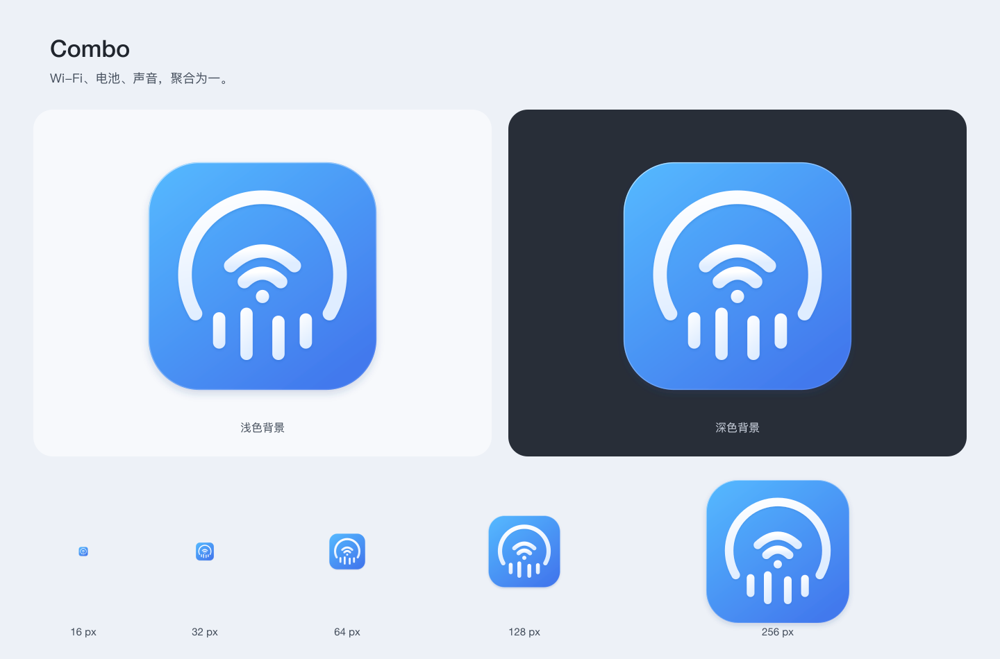

# Combo · AppIcon 设计稿

确认日期：2026-11-06；归档整理：2026-11-12。当前蓝白玻璃图标由电量弧、Wi-Fi 双弧与圆弧排列的四条音乐柱组成，与[面板、设置和引导](../README.md)统一存放。



[浏览器预览](https://fanglinwei.github.io/Combo/design/liquid-glass/icons/preview.html) 使用网页文字与现有图标资源，随窗口宽度重排；尺寸对照按 16–256 CSS 像素显示，不随整张预览图缩放。

## 文件与用途

| 文件 | 用途 |
| --- | --- |
| [combo-app-icon.svg](combo-app-icon.svg) | 唯一可编辑矢量主稿 |
| [combo-app-icon.png](combo-app-icon.png) | 1024px 透明 PNG，供中英文 README 和设计稿使用 |
| [preview.png](preview.png) | 浅深背景及 16–256px 尺寸对照 |
| [render.cjs](render.cjs) | 从主稿生成原生尺寸、1024px 分发件与预览 |
| [AppIcon.appiconset](../../../../Combo/App/Media.xcassets/AppIcon.appiconset/Contents.json) | Xcode 打包所需的 10 个原生图标文件 |

文档侧不再保留另一套 16–512px PNG 或重复的 1024px 分发件。原生目录中相同像素尺寸的 1x／2x 文件按资源清单保留；1024px PNG 与原生最大尺寸文件一致。

## 更新方式

修改唯一 SVG 主稿后，在已有 sharp 的 Node.js 环境运行：

```sh
NODE_PATH=<现有 node_modules> node docs/design/liquid-glass/icons/render.cjs
```

脚本读取原生 `Contents.json`，直接更新打包所需尺寸，同时生成本目录的 PNG 和预览；不会重新建立文档侧的尺寸副本。更新图标后还需同步设置和引导源稿中内嵌的 AppIcon，再按[统一导出步骤](../README.md#设计依据与维护)更新浏览器稿，并运行资源检查和适用的原生构建检查。

设置与引导使用原生应用图标；实时菜单栏图标由 `IconRenderer` 按本机状态绘制，独立于静态 AppIcon。品牌蓝色不规定界面按钮色，原生界面颜色和几何以 `Combo/Views/Theme.swift` 为准。

## 当前几何

1024px 透明画布；底座为 `(100,100,824,824)`，圆角 184px。背景从 `#55BAFF` 渐变到 `#4279ED`，标志为 `#FFFFFF → #DFEDFF`，保留柔和落影和细边缘光。

外弧为 `M20.6 65 A34 34 0 1 1 79.4 65`，宽 6、圆头。四柱横向中心为 31、43、57、69，底沿为 80.4、85.4、85.4、80.4；长度为 16、23、19.5、15.5，宽 5.4、圆角 2.7。柱体竖直、两侧上提、中间下沉；整体以 8.24 倍放大并置于 `(100,112)`。

音乐柱是播放态的静态表达，PNG 不含动画；16px 以整体轮廓辨识为主。旧候选、透明圆点标志及历史审查产物已移除。

## 验证边界

资源检查覆盖设计稿导出同步、1024px PNG 尺寸及其与原生文件的一致性。浏览器材质、原生窗口行为及 Finder／Dock 缓存显示需单独验收；历史审查记录不代替当前验证。
